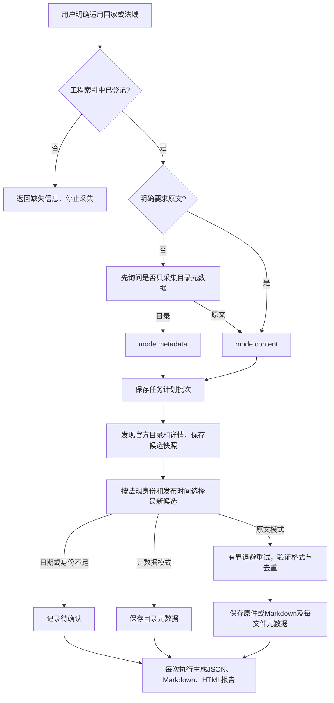

# law-crawler · 官方法规采集 Skill

`law-crawler` 将官方法规的目录采集、原文下载、来源记录、版本选择与去重整理成可按批次执行的流程。它的目的是建立**法域明确、来源可追溯、文件可核对、任务可重跑**的本地法规资料库，供后续研究或内容处理使用。

用户必须明确提供适用国家/法域，且该法域已记录在工程索引中。除非用户明确要求下载法规原文，agent 必须先询问是否只采集元数据（目录），获得选择后执行。采集结果不代表法规已核实为现行有效。

工程按四个顶层目录组织：

| 目录 | 内容 |
| --- | --- |
| `skill/` | 完整法规采集Skill、兼容命令和采集测试。 |
| `web/` | Web看板、资源浏览器、智能体观测和看板测试。 |
| `deploy/` | 安装、服务器配置、统一启动/测试工具及工程文档。 |
| `data/` | 本地法规资料、报告、临时文件和运行状态；除目录说明外不进入Git。 |

## Agent 支持与安装

同一个 [SKILL.md](skill/law-crawler/SKILL.md) 使用通用 Agent Skills 格式。采集核心只依赖完整Python 3.10+标准库（含ssl、sqlite3及系统文件锁）；三阶段模型处理另需可用Ollama服务与已安装模型，PDF文本提取需可选pypdf；浏览器辅助使用所在agent提供的工具，核心CLI无须专有连接器或当前对话。macOS/Linux使用POSIX锁，Windows使用msvcrt锁；当前完成macOS实跑与Windows分支模拟，尚无Windows实机验收。完整可维护源码统一位于`skill/law-crawler/`，各工具链接同一完整目录使用；安装器不生成源码副本。

直接检查并安装完整skill，无须打包或生成代码：

```sh
python3 deploy/tools/check_skill.py
python3 deploy/tools/install_skill.py --agent codex
python3 deploy/tools/install_skill.py --agent claude
python3 deploy/tools/install_skill.py --agent qoder
python3 deploy/tools/install_skill.py --agent deepseek-harness --scope project --project /path/to/project
python3 deploy/tools/install_skill.py --agent opencode
python3 deploy/tools/install_skill.py --agent workbuddy
```

| Agent | 默认用户级安装目录 | 项目级安装目录 |
| --- | --- | --- |
| Codex | `$CODEX_HOME/skills/`，未配置时 `~/.codex/skills/` | `.agents/skills/` |
| Qoder CLI | `~/.qoder/skills/` | `.qoder/skills/` |
| DeepSeek Harness | 用`--dest`显式指定配置中的`dshHome/skills` | `.dsh/skills/` |
| Claude Code | `~/.claude/skills/` | `.claude/skills/` |
| OpenCode | `$XDG_CONFIG_HOME/opencode/skills/`，未配置时 `~/.config/opencode/skills/` | `.opencode/skills/` |
| WorkBuddy | `~/.workbuddy/skills/` | `.workbuddy/skills/` |

项目级安装用 `--scope project --project /path/to/project`。自定义技能集合目录用`--dest /path/to/skills`，其他完整技能包可用`--source /path/to/law-crawler`；安装器在目标集合目录下建立目录链接，保留整个包的相对结构；重复链接幂等，已有副本或其他链接拒绝覆盖。客户端不识别链接时使用自定义目录或显式读取真实SKILL.md，不自动复制。安装后在目标 agent 的技能列表确认识别，必要时重新打开会话。本文验证安装器和包结构，不代表已在所有 agent 的交互会话逐一验收。Claude Code 与 OpenCode 路径分别依据 [Claude Code 官方文档](https://code.claude.com/docs/en/skills#choose-where-skills-load)和 [OpenCode 官方文档](https://opencode.ai/docs/skills/)。

## 使用前需要确认什么

如需在云服务器运行 Claude Code、接入 DeepSeek 并查看智能体与批次状态，参见[阿里云部署与只读 Web 看板](deploy/docs/deployment-ecs.md)。

仅部署批量下载时，使用[下载专用服务](deploy/docs/deployment-ecs.md#下载专用服务)。该服务直接执行完整skill中的归档脚本，独立固定源码版本和工作区，不安装Claude/Ollama、不调用翻译模型，也不切换现有看板版本。服务器登录、真实下载和文件哈希核验通过后，才能记录为已部署运行；准备好部署包不等于部署完成。

| 必须确认 | 规则 |
| --- | --- |
| 适用国家/法域 | 用户显式提供；不能根据平台域名、历史任务或默认索引猜测。 |
| 索引登记 | skill随附`skill/law-crawler/countries/*/index.md`；已有工作区countries优先。EU 中明确列出的成员国章节也有效。未知法域在网络请求和任务创建前拒绝。 |
| 采集模式 | 未明确要求原文时，agent 询问“是否先只下载元数据（目录）？”，等待选择 `metadata` 或 `content`。 |
| 工作区与配置 | 工作区countries优先；源码工程读取skill内索引和默认配置时，相对下载输出集中到`data/`。独立包和显式用户配置仍按指定工作区解析。 |

目前索引包含印度尼西亚、加拿大和 EU 聚合入口；EU 成员覆盖以文件实际章节为准，目前列有德国、法国、荷兰、意大利。EU 索引不代表全部 27 国、欧盟自身法规或所有平台都已适配。中文、规范英文及已登记 ISO 别名可用；别名不会绕过索引登记检查。

新工作区按包内[工作区准备](skill/law-crawler/references/workspace.md)执行。将SKILL_DIR替换为当前SKILL.md所在目录、WORK_ROOT替换为用户选定的绝对路径，选择实际Python 3.10+解释器：

```text
python -X utf8 "SKILL_DIR/scripts/prepare_workspace.py" --root "WORK_ROOT" --jurisdiction Canada
python -X utf8 "SKILL_DIR/scripts/prepare_workspace.py" --root "WORK_ROOT" --jurisdiction Canada --initialize
```

第一条只读检查；第二条仅在工作区尚无索引时按用户明确法域选择模板，并补齐缺失配置，不覆盖已有索引/配置，不访问网络或创建采集批次。已有索引未登记的法域不得借模板补入。返回逐平台`adapter_supported`，区分登记、适配及网络验收。

## 通用skill的维护约定

保持三级加载：frontmatter提供中英文触发及范围；SKILL.md保存必要输入、执行路由和交付约束；按需读取references，历史观察留在references/history。将可执行逻辑放scripts，将国家索引与默认配置直接维护在skill的countries目录。assets仅在实际需要其他产出资源时使用，不保存重复索引。当前无超过10k词的参考文件，历史资料仍提供定位关键词。

将生成来源标记放在`metadata.agent_created: "true"`，遵循[Agent Skills规范](https://agentskills.io/specification)的字符串映射扩展，而非新增私有顶层字段。SKILL.md不依赖会话历史、本机绝对路径、指定浏览器接口或本仓库旧报告；字段/URL等领域规则来自随包参考资料和用户工作区的真实索引，机器目录与工具能力在运行时解析。

将整个skill直接维护在[`skill/law-crawler/`](skill/law-crawler/)，包括说明、参考资料、国家索引、默认配置和运行代码。运行实现的唯一位置是[`scripts/law_crawler/`](skill/law-crawler/scripts/law_crawler/)，`scripts/*.py`仅作命令入口；不再生成代码副本或生成清单。`skill/law_crawler/__init__.py`仅为兼容导入桥，直接加载skill中的同一套模块。不要从外部工作区复制个人配置。目录职责、兼容入口与开发流程见[源码结构说明](deploy/docs/development.md)。

2026-10-15通用性复验：263项测试通过；独立代理仅用完整skill包在中文含空格临时目录完成18条前向命令观察，所有skill命令0次网络尝试。通用性审查报告保存在本地 `data/reports/`，不随源码发布。这不代表其他agent客户端界面、Windows实机或实时官网均已验收。

## 原始归档、低成本处理与独立复核

明确原文范围后，可使用新增 `pipeline` 流程：**冻结来源清单 → 原始响应落盘 → 本地确定性提取/去重 → Ollama生成中英文稿 → 独立高质量模型复核 → 输出报告**。确定URL后不再因格式、版本或正文判断提前丢弃响应；403和不完整响应也保留证据，但不能作为成功正文处理。

保留原始文件、提取的原文Markdown、简体中文Markdown、英文Markdown及元数据。优先用程序完成哈希去重和无损清洗，将模型计算用于翻译；模型不得决定删除原始文件，也不能用相似标题合并不同法规。新流程使用国家目录中的独立 `pipeline/`，不把未复核译稿混进现有正式法规记录。


参见完整skill内的[三阶段运行说明](skill/law-crawler/references/staged-pipeline.md)，包含清单、模型配置、重跑与复核导入格式。当前先实现本地Ollama路径；通用模型客户端具有OpenAI-compatible能力，但流水线不会因此自动启用付费云端批处理。复核可由当前agent中的独立高质量模型完成，导入其实际审核记录；CLI不会把未执行的复核标记为通过。

法规翻译采用目标语种的规范法律表达，避免逐词直译。当前默认中文中国大陆、英文英国OPC；保持原法规主体、权利义务、条件、例外及效力，不套用中国或英国实体制度。按[法律翻译文体](skill/law-crawler/references/legal-translation.md)在manifest中指定`translation_style_path`，将官方依据、提示规则和版本冻结到批次；初译及回退使用同一规则，独立复核须同时检查语义与文体。配置变化建立新批次并隔离缓存，旧批次不被追认为符合新文体。译文始终标为非官方。

分别记录下载、提取、模型、复核耗时与质量问题。将本地API账单费用记为0，将电费、硬件及无法取得的订阅模型分摊费用记为未知，不把它们合计为“全流程零成本”。译文属于派生参考稿，最新版本与法律效力仍需来源证据。

2026-10-21印尼实跑验证：官方PDF共5页，本地模型处理11个文本块并保存原文、中英文稿；离线重跑复用11块、0次下载和0次模型调用。独立复核发现未翻译段落、日期字形缺失和附件语义问题，结果为需修订。流程能够留存和拦截问题，但这不证明本地模型已经具备稳定的法规翻译质量。详细运行证据保存在本地 `data/reports/staged-indonesia-20261021/`，不随源码发布。

同日修订验证：新批次 `id-repaired-20261021-r1` 经独立逐页复核通过，R01–R10全部关闭。补齐缺译段落、公布日期和公报号，恢复组织图12条父子关系，并校正机构名称、条款编号、附件修改范围和术语。先用本地模型定向重译2段（21.47秒），发现16A被误译为16后，由编辑agent整稿修订（210.34秒），再由不同agent独立复核（140.17秒）。原PDF和旧稿不变；三语修订稿另存，新批次重跑0下载、0模型调用。仅本地API费用为0，编辑/复核订阅费用归属及硬件成本未知。此结果仅证明本样本文本对应质量，不证明本地模型单独达标或法规现行效力。

按[修订与重验流程](skill/law-crawler/references/staged-pipeline.md)使用 `repair-import`：冻结父批次及原件哈希，提供覆盖全部问题的修改清单和页码证据，导入完整三语稿，再用不同复核者的实际记录执行 `review-import`。修订不覆盖旧稿；待复核提示保留为历史生成状态，以批次复核记录为最终状态。对照报告位于本地 `data/reports/staged-indonesia-repair-20261021/comparison-report.html`（同时提供Markdown和JSON），不随源码发布。

扫描件与复杂PDF现支持 `transcription_path`：导入覆盖全部页面的外部OCR或人工转录，绑定原PDF及转录SHA，保留每页方法与证据，再交本地模型翻译及独立复核。混合PDF不得漏掉无文字页；组织树在Markdown中保留缩进。遇到日期/公报号显示为乱码时，用另一渲染器交叉核对，不能把单一引擎故障判断为原件缺失。完整格式见上述流程文档；现可用[本地自动OCR](skill/law-crawler/references/local-ocr.md)调用已安装引擎，保留逐页图、坐标和置信度。

扩样验证（2026-10-21）：3份印尼法规共11页，覆盖原生文本PDF（26/2025）、真实扫描PDF（88/2014）及组织图（24/2026）。15次本地模型调用耗时500.78秒；首审发现20项问题，经修订及另一agent独立终审全部关闭。原件、初稿和三语修订稿均保留；本地API费0，订阅归属费用与硬件成本未知。人工扫描转录耗时未精确计量，单列未知/估算；不能称为全自动OCR验证。文本页脚验证网址仍明确未知，未验证表格、法律现行效力或全站最新。

本轮同时修复派生文件重跑覆盖问题：全部渲染内容参与产物地址计算，同路径不同字节拒绝写入，已审核请求变化时保留原请求并要求新批次。实跑验证新渲染批次复用15块、0次模型调用，旧审核产物和父证据哈希保持一致；历史一次提示语覆盖已精确恢复并留存审计记录。455项测试通过。完整质量、各阶段耗时、成本和逐项闭环见本地 `data/reports/staged-indonesia-expanded-20261021/validation-report.html`（另有Markdown/JSON）。

本地OCR入口：`python deploy/run.py skill ocr --pdf ARCHIVED.pdf --output NEW_OCR_DIRECTORY --engine apple-vision --language id-ID`。macOS使用可用Swift/Apple Vision；Tesseract后端需已安装程序及语言包（印尼语`ind`），不会自动安装。识别成功后用输出`transcription.json`连接三阶段处理。表格可通过`skill ocr-tables`按人工确认格线归格，保留空格和跨格待核提示；这不是通用自动表格检测。详细命令、格式及验收边界见[本地OCR与表格](skill/law-crawler/references/local-ocr.md)。

自动表格入口：使用具备`numpy`、`Pillow`的解释器执行`python deploy/run.py skill auto-tables --sidecar OCR_TRANSCRIPTION.json --output NEW_DIRECTORY`，从页图检测横纵格线，保留合并格的`rowspan`/`colspan`及跨页候选，不需先填写格线坐标。跨页候选须独立确认；无格线、严重倾斜和边界损坏仍可能失败。翻译后用`skill check-table-translations --source SOURCE.txt --zh ZH.txt --en EN.txt --output NEW_AUDIT.json`检查HTML片段、跨度、数值及币种标记；结构通过不等于语义通过。

自动OCR与表格实跑（2026-10-21）：88/2014扫描件3页、57/2017含价格表扫描PDF6页，均从原始归档进入Apple Vision印尼语全页OCR，再由本地`qwen3:8b`生成中英文初稿。OCR合计20.03秒；10次本地模型调用384.97秒。首审发现62项问题，经独立编辑修订后由另一子代理逐页终审全部关闭；三语表格均保留8行4列、16个价格值、地区排除条件及Rp/kg单位。原PDF、原始OCR、机器初稿和三语修订稿分别保留；通过只针对修订稿，不代表自动识别无误。57/2017在官方目录标为已失效，仅作为历史格式样本。

本轮463项测试通过；OCR和表格缓存哈希验证、工程目录外命令执行、处理批次与修订批次重跑均通过，重跑无新增模型调用。表格格线由页图人工确认，Tesseract未做实机验收；复杂合并单元格和多页续表不在本次范围。编辑实测289.47秒，三语首审200.71秒、终审124.21秒，另有表格OCR审计70.26秒；扫描OCR审计已包含在其首审时间中，不能重复累加。人工定格时间未单独计量；本地API费0，订阅、硬件和电力费用未知。详细质量、耗时、成本及逐项修复证据见本地[Markdown报告](data/reports/staged-indonesia-ocr-table-20261021/validation-report.md)与[HTML报告](data/reports/staged-indonesia-ocr-table-20261021/validation-report.html)，这些运行资料不随源码分发。


## 全量归档任务与独立审核队列

全量请求使用[批量归档与覆盖验收](skill/law-crawler/references/bulk-collection.md)，分别跟踪来源覆盖、目录穷尽、原件、三语处理和独立复核。普通下载命令仍按有限数量执行；调大`limit`不能证明全站完整。印尼司法规范保留PERMA、SEMA实际文种；SEMA不自动等同中国司法解释，也不混入个案判决。

仅要求原始下载时，先完成目录发现，再用`skill bulk-download-fast --root WORK_ROOT --jurisdiction Indonesia --rerun-batch BATCH_ID --workers 2`续跑已冻结目录。默认2路、上限5路，逐详情小断点和单写入者合并状态；完整文件经SHA校验后跳过，已知失败默认保留，需显式`--retry-failed`重试。此入口只下载并记录元数据与报告，不导出模型处理队列、不启动OCR或翻译；配置、来源访问和原文件体积限制仍按原计划执行。

```sh
python3 deploy/run.py skill bulk-archive --root "$PWD" --jurisdiction Indonesia --batch-id id-full-RUN_ID --phase all
python3 deploy/run.py skill bulk-archive --root "$PWD" --jurisdiction Indonesia --rerun-batch id-full-RUN_ID --phase all
python3 deploy/run.py skill bulk-process --root "$PWD" --jurisdiction Indonesia --manifest-dir COUNTRY_DIR/pipeline/bulk/id-full-RUN_ID/manifests --output COUNTRY_DIR/pipeline/bulk/id-full-RUN_ID/processing --model-config MODEL.json --ocr-engine apple-vision
```

把`COUNTRY_DIR`、`MODEL.json`替换成实际绝对路径。归档批次先冻结计划，逐页保存断点和响应，原件统一在配置下载路径的`Indonesia/pipeline/raw/`。MA目录分别遍历PERMA、SEMA；Kemendag依据官方页码和总量连续枚举，避免官网Next跳过中间页，并保留统计变化、重复页和未穷尽原因。未实现分页的来源明确报告incomplete。已发现的不同版本和附件先归档；行政决定、身份待核或不支持格式继续保留原件及处理排除原因。

`active-manifests.json`列出当前每个原件SHA对应的完整来源快照，历史清单保留但不重复送入处理。处理器冻结输入集合、模型及中国大陆中文/英国英文文体，逐件OCR和表格识别，输出原文、中英文稿、计时、用量和独立复核请求。默认每件最多执行3次；失败仅显式`--retry-failed`重试，累计模型调用上限不随重跑重置。新增清单或配置变化使用新处理目录。独立复核必须通过真实审核记录导入；初译完成不等于审核通过，修订沿用已有不可变批次和逐项闭环机制。

归档进行中可给`bulk-process`追加`--await-export-seconds 86400`：先冻结等待策略、生产者计划、模型与文体，导出清单就绪后自动接续；超时或配置漂移保留待处理原因。按国家串行执行模型，默认有界等待处理锁1800秒。保留原始OCR和全部关联文件，逐链接区分正文、正式附件、草案与相关资料；同页文件不能自动继承主法规身份，也不能仅凭PDF隐藏文字中的“草案”判定文件身份。

使用`skill bulk-report`并列汇总归档、处理及初稿/修订审核批次，生成JSON、Markdown和HTML。运行中的状态和模型事件按当时原始字节另存哈希证据快照；审核通过须重新核验全部产物、风险标记和原问题闭环，不把待审核批次算作通过。

OCR和表格缓存按输入、实现、依赖配置及产物哈希验证；失败或过期目录保留，使用新的attempt目录。已有冻结准备输入的模型批次验证后续跑，复用已完成片段；模型请求的超时、传输和JSON错误分别记录，不能把原因未知的旧错误改写成已确认超时。

2026-10-21全国任务执行证据保存在本地`data/reports/indonesia-full-20261021/`，批次`id-full-archive-20261021`保存在配置国家目录。当前仍有全国来源覆盖、分页适配及TLS/403缺口；[来源覆盖报告](data/reports/indonesia-full-20261021/source-coverage.md)与[归档实时报告](data/downloads/Indonesia/pipeline/bulk/id-full-archive-20261021/report.html)分别记录范围和实际结果，不能将本轮首屏收集、网站统计或样本审核称为全国全量完成。浏览器补收另行记录真实方法及未知HTTP终点，不改写CLI失败历史。未测量费用保持null，完整用量与质量以具体批次和审核哈希为准。

本轮已连续枚举Kemendag官方目录241页、2,406条混合文种记录；原件抓取与本地处理继续运行。SEMA 4/2026（6页）和PERMA 3/2026（8页）已完成原文及中英文修订，独立审核分别闭环22项、29项问题，修订批次重跑复用且不新增模型调用。保留初稿失败记录，不把这两份通过扩大到其他文件。另已核验Kemendag 15/2026正式正文与相关草案各18页的文件角色；此项身份核验不代表36页全文翻译通过。持续任务的[Markdown快照](data/reports/indonesia-full-20261021/execution-report.md)与[HTML快照](data/reports/indonesia-full-20261021/execution-report.html)列示实际原件数量、质量、耗时、用量和未知费用；当前会话按批次独立复核，没有自动强模型终审服务。

## 传统目录与原文采集逻辑



元数据模式采集目录、详情、来源、法规身份、日期及原文链接，不请求法规原文附件。原文模式在选定候选后请求并验证文件。目录仅为有限发现范围；最新选择只针对本批次发现的候选，不保证全平台全历史的最新版本。

同法规不同版本、多来源均比较有证据的 `published_at`，取最新公布日期。必须有明确法规身份才能分组；未知日期、同日并列或身份不足保留候选并标记待确认；需要选择执行项时使用稳定来源排序，仍不认定唯一最新，不能拿下载时间、网页更新时间或 URL 排序代替最新公布日期。历史文件及来源记录继续保留。

## 命令示例

在 agent 中提出：

> 使用 law-crawler，适用法域加拿大，先只采集目录元数据，每个平台最多检查 4 个详情页。

> 使用 law-crawler，适用法域德国，下载法规原文，验证 1 份并检查去重。

在工程中直接运行：

```sh
# 加拿大目录元数据
python3 deploy/run.py skill download \
  --root "$PWD" --jurisdiction Canada --mode metadata \
  --platform all --limit 6 --per-platform-limit 2 --max-details 4

# 印尼原文：每平台限量1份
python3 deploy/run.py skill download \
  --root "$PWD" --jurisdiction Indonesia --mode content \
  --platform all --limit 11 --per-platform-limit 1 --max-details 3

# EU索引按成员国分流
python3 deploy/run.py skill download \
  --root "$PWD" --jurisdiction EU --mode content \
  --platform all --limit 4 --per-platform-limit 1 --max-details 2

# 仅生成计划，不访问网络
python3 deploy/run.py skill download \
  --root "$PWD" --jurisdiction Germany --mode metadata --plan-only

# 同一批次重跑失败和待执行项，沿用计划内法域与模式
python3 deploy/run.py skill download --root "$PWD" --rerun-batch BATCH_ID
```

独立命令入口为 `skill/law-crawler/scripts/download_regulations.py`，安装副本中的相对路径相同。新批次 CLI 强制显式提供 `--jurisdiction`（兼容显式 `--country` 别名）及 `--mode`，不会默认原文下载。`--index` 如指定须匹配法域登记索引。

| 参数 | 含义 |
| --- | --- |
| `--jurisdiction` / `--mode` | 新批次的显式法域和 `metadata` / `content` 模式。 |
| `--batch-id` | 自定义安全批次 ID；缺省生成新 ID。 |
| `--plan-only` | 仅生成参数执行计划，不访问网络。 |
| `--rerun-batch ID` | 沿用已有计划，重跑失败/待执行项；传入法域与模式时须一致。 |
| `--rerun-all` | 重跑全部项，已下载有效文件仍可命中缓存。 |
| `--max-attempts` | 默认 3 次，包含首次请求；失败后最多再试两次。 |
| `--backoff-base` | 指数退避等待基数，默认 1 秒。 |
| `--platform` / `--limit` | 平台域名或 `all`、原文总文件限量；目录发现范围由 `--max-details` 约束。 |
| `--per-platform-limit` / `--max-details` | 单平台原文文件限量、详情页检查上限；前者不限制目录条数。 |
| `--timeout` / `--delay` | 请求超时、详情间隔，默认 20 秒 / 1 秒。 |
| `--refresh` | 重取已知原文 URL，检查内容变化并保留历史。 |
| `--experimental-sources` | 显式启用 JDIHN 官方开发部署备用路径，成功不代表正式入口恢复。 |

详见 [批次工作流](skill/law-crawler/references/batch-workflow.md)。

## 保存位置与输出

源码工程的默认配置位于`skill/law-crawler/countries/global-config.properties`；独立用户工作区的配置位于其`countries/global-config.properties`并具有优先级。

```properties
downdloadDir=./downloads/
```

源码工程使用该内置配置时，相对输出归入 `data/`，即 `data/downloads/`。独立安装包及显式用户配置仍相对其工作区解析。

保留原键名 `downdloadDir`，兼容 `downloadDir`。基础目录内按国家分流；相对路径按 `--root` 解析，绝对基础目录同样追加国家子目录。目录拒绝符号链接和路径逃逸。

```text
data/downloads/
├── Indonesia/      # 文件、独立元数据和去重状态
├── Canada/
├── Germany/
├── France/
├── Netherlands/
├── Italy/
└── .batches/
    └── <batch-id>/  # 执行计划、候选快照和历次尝试报告
```

| 内容 | 保存与核对规则 |
| --- | --- |
| 目录元数据 | 每法规候选包含来源链接、身份、日期、原文链接、选择与处理状态。 |
| PDF、办公文档、扫描图片、ZIP | 按真实格式保留官方原始字节。 |
| HTML、XML、JSON 法规文本 | 转换为 Markdown 保存，保留原始响应审计副本及转换来源。 |
| 每文件元数据 | 每份下载内容单独生成 JSON，记录原格式/哈希、实际文件格式/哈希、所有来源及状态。 |
| `crawl-state.sqlite3` | URL、内容、请求状态和历史版本的持久索引。 |
| `.batches/<ID>/` | 保存批次计划及 `candidates.json` 原文 URL 快照。 |
| `attempts/0001/` 等 | 各次执行结果；生成机器 JSON、Markdown 与固定版式 HTML 报告。 |

HTML/XML/JSON 必须先确认是法规原文，不能将导航、错误页、挑战页转换后当成成功法规。文本转换保留层级和内容，结果完整性仍受来源与格式限制；传统下载流程不对PDF/扫描图片自动OCR；明确启用本地OCR入口后可处理PDF，其他二进制格式不自动转换。详见 [文件格式](skill/law-crawler/references/file-formats.md)。

Markdown还需核对源结构，不能仅以文字片段存在或文件哈希正确验收。`structured_text_v2.4`字段标注仅显示名称和值，不追加`(XML 路径)`括号；保留日期角色、具名条款层级、表格行列/跨度、脚注及未知结构；双语节点分别标明English/Français并保留边界；加拿大登记日期、XML合并日期与制令日期分别标注，不混为公布日期。MathML保留源结构，缺失idref脚注标未解析。现有文件可用下述离线批次重建，旧Markdown及元数据保存在`conversion-history/`，原始字节、来源与请求计数保留；后续旧缓存也会自动升级。Markdown结构修复报告保存在本地 `data/reports/`。此前加拿大文本存在检查没有覆盖这些结构问题，不能继续作为结构验收证据。

```sh
python3 deploy/run.py skill rebuild-markdown \
  --root "$PWD" --jurisdiction Canada --batch-id canada-markdown-rebuild-RUN_ID

python3 deploy/run.py skill rebuild-markdown \
  --root "$PWD" --rerun-batch canada-markdown-rebuild-RUN_ID
```

元数据中 `published_at` 是法规公布日期，`updated_at` 是官方明确提供的网页/记录更新时间，`effective_region` 是适用国家/地区；缺证据时为 `null`。法域输入用于任务范围和存储，不自动证明每一法规全国适用或当前有效。字段说明见 [元数据](skill/law-crawler/references/schema.md)。

## 合并单元格、跨页续表与法律翻译验证

2026-10-21新增正式样本为印尼Permendag 07/2020完整9页（官方目录标为历史失效，仅作处理验证）。自动识别附件两页4列表，11处纵向合并锚点与独立原图核验一致，人工格线输入为0；跨页候选经独立确认，仍保留原始两页片段。另以43/2014六页续表及57/2017普通表格作检测基准，不计作本轮完整翻译样本；真实横向合并单元格尚未覆盖。

本轮执行原始归档、Apple Vision OCR、本地qwen3:8b处理、三语修订及独立复核。首审53条历史记录最终关闭：52项有效缺陷已修复，1项原件大小写误报撤回并保留更正证据。终审核对全文、22个商品子项、33个价格和6项脚注；中文中国大陆、英文英国的文体配置冻结到批次，保留原文和非官方中英文译文。自动表格检查另修复中文紧邻数字漏检，最终结构检查0项问题，语义质量仍由独立复核判定。

OCR含渲染10.711秒、自动表格0.536秒、本地推理431.690秒（10次调用）、编辑674.823秒、首审116.823秒、终审338.857秒；阶段计时不相加冒充端到端工时。本地模型API费为0，订阅归属、硬件电力及总费用未知。处理与修订批次重跑均无新增模型调用；相关测试共478项通过（含修正旧安装测试后的重跑），完整skill源码只读检查通过。浏览器本地预览被访问策略限制，未完成浏览器视觉排版验收；原图及HTML表格结构已核验。

完整质量、成本、计时及逐项证据见本地[Markdown报告](data/reports/staged-indonesia-complex-tables-20261021/validation-report.md)和[HTML报告](data/reports/staged-indonesia-complex-tables-20261021/validation-report.html)。报告与下载数据不随源码分发。检测实现由local_ocr子代理完成，三语修订由table_sample完成，独立复核由ocr_table_review完成，主代理负责实跑、导入与整合。

## 去重、重试与报告

去重保持 URL 规范化、本次队列、SQLite 持久状态、SHA-256 内容去重四层。相同字节合并来源，不同内容保留版本；不按标题相似或语义相似删除原件。复用前验证本地文件，缺失或损坏则重新获取。最新候选选择与字节去重分别记录，历史来源与证据不被新版本覆盖。

默认批次重跑先为全部有效成功缓存预留总量及平台额度，再处理失败/待执行项，避免限量跳过项因缓存未计数而扩采。历史异常超额文件保留，本轮报告按原计划限额呈现；本轮文件数与历史库存数分别报告。

每文件请求默认最多 3 次，指数退避等待；每次尝试及最终成功/失败均记录状态与原因，达到上限后继续其他项。缓存命中记录为复用，不伪造网络下载。TLS、403、未适配导出、错误页和浏览器工具故障需要明确区分，不能关闭 TLS 校验或绕过访问控制。

每轮报告提供 Markdown 和可离线阅读的固定版式 HTML，展示任务摘要、平台状态、文件/候选结果、失败原因及待确认项。执行退出码或一个成功样本不证明整个平台可用；结果以报告、实际文件和哈希核对为准。

## 工程维护与验证证据

目录树、唯一源码位置和检查流程见[源码结构说明](deploy/docs/development.md)。本地下载资料、历史报告和临时文件统一归入`data/`；历史证据原字节保留，旧路径通过迁移记录追溯，资料不随源码提交。

| 路径 | 职责 |
| --- | --- |
| [SKILL.md](skill/law-crawler/SKILL.md) | 跨 agent 输入确认、执行和交付说明。 |
| `skill/law-crawler/scripts/law_crawler/jurisdiction_registry.py` | 只读索引登记与法域校验。 |
| `skill/law-crawler/scripts/law_crawler/download_regulations.py`、同目录`platform_adapters/` | 执行调度与官方目录/详情解析。 |
| `skill/law-crawler/scripts/law_crawler/`中的存储、格式和元数据模块 | 存储、去重、格式和元数据基础能力。 |
| `skill/law-crawler/scripts/` | 直接维护的唯一完整运行包，以及采集、三阶段处理、OCR和表格重建等命令入口。 |
| `skill/law_crawler/__init__.py` | 工程兼容导入桥，加载上述运行包，无业务实现。 |
| `skill/law-crawler/countries/` | 国家索引及默认配置，直接维护并随skill安装。 |
| skill目录的四个Python兼容命令 | 仅兼容旧CLI，实际实现位于skill内的law_crawler包。 |
| `web/observer/`、`deploy/` | 独立看板和服务器部署，不打入skill。 |
| `deploy/tools/install_skill.py` | 目标 agent 安装；不修改权限配置。 |
| `skill/tests/`、`web/tests/`、`deploy/tests/` | 分别验证采集、看板和部署，固定采集样本位于skill/tests/fixtures。 |
| `data/reports/` | 本地验证报告与历史实跑证据，已加入 `.gitignore`，不纳入版本控制。 |

```sh
python3 deploy/tools/check_skill.py
python3 deploy/run.py test -v
python3 deploy/tools/install_skill.py --agent codex
```

`check_skill.py`只读检查必需资源、Python语法与内部依赖，不改写文件；安装器直接复制完整skill目录，不生成另一套源码。独立 skill 包不包含下载原件或状态数据库。本次源码归并通过363项测试；独立测试子代理在中文含空格临时路径验证了完整skill副本的初始化、加拿大计划与同批次重跑，产出两轮Markdown、HTML报告，未访问网络。新增平台必须验证官方目录→详情→原文链路，再复跑核对去重；离线测试不替代真实网络验收。

最新目录选择保存在各国家目录 `latest-selection.json`；已下载资料的当前版本选择保存在 `current-regulations.json`。每份文件的 JSON 同时记录 `selection` 与 `preferred_source`，历史原件继续保留。目录候选按法规身份、公布日期和官方文本版本区分，未知日期不会覆盖已有明确新版。

每轮还有 `attempts/000N/execution-plan.json`、`execution-plan.md` 和下载前的 `file-plan.json`；同一批次不允许并发执行。默认重跑沿用已成功文件，恢复失败的目录/详情发现和未完成原件任务；正文格式中的其余链接作为备选，已取得一个可用格式后记录跳过。

历史采集、核验更正与浏览器排查记录见[历史样本验证](deploy/docs/validation-history.md)；当前能力按实际运行报告确认。

跨agent浏览器分层对照可运行以下命令，用自己可用的浏览器工具访问stdout中返回的URL，并核对fixture.json中的marker和实际附件SHA；诊断文件保存在报告证据目录，不导入法规库：

```sh
python3 deploy/run.py skill browser-healthcheck \
  --duration 180 --output-dir data/reports/browser-healthcheck-RUN_ID
```

### Web下载进度

在观测台的“全量原文下载”区域查看当前服务器批次：已发现详情总量、已尝试详情、按SHA去重的成功原始文件、失败文件引用及原因、配置并发与最近执行并发、下载数据更新时间。每5秒刷新；区分正在下载、已暂停、已结束（有缺口）及状态未知。详情尝试100%不代表全部原文下载成功，也不证明全国法规覆盖完整。

由只读API `/api/overview` 的 `download` 字段提供数据。下载器在 `fast-download/status.json` 中原子记录小型摘要，Web不读取大型`state.json`；旧批次可用 `python deploy/tools/refresh_download_progress.py --batch-dir BATCH_DIRECTORY` 补充`progress.json`，保留原始下载更新时间。服务配置由`runtime/*/active-download.json`绑定，读取器只接受下载根下的合法批次路径，使用只读systemd查询确认运行状态；不提供启动、暂停或重试操作。

下载进度的运维主卡统一使用“详情归档任务”口径：总量＝完整下载＋下载中＋待下载＋失败/不完整＋状态待核验；不以已尝试代替已下载，配置并发也不代替下载中数量。运行器按实际提交的任务记录活跃与待处理分区。批次历时从创建至当前快照/结束，包含目录发现、等待及暂停；旧批次缺少活跃时段证据时，实际活跃下载时长标待核验，结束后不继续计时。

法规/司法指导文件按官方元数据中的法域、机关、文种、编号、年份五字段归并，同一身份的多来源和多版本只计一次；缺字段、字段状态未确认或文种不明者单列待核验，机关/文种别名未经证实不擅自合并。不同原件按SHA去重，并依明确角色证据互斥区分正文、附件、关联材料及用途待核验；正文/附件角色冲突归待核验。没有明确官方版次或整编截至日期时不根据格式、SHA或公布日推断版本，数量显示待核验。这些统计不代替法律身份、效力的独立核验。

失败任务定向续跑可显式设置`--retry-failed --workers 5 --max-file-mib 512 --refresh-failed-details`：保留冻结计划，在独立运行策略记录上限变化；以流式归档与分块SHA支持大文件，复用所有已验证成功原件。对缺原件、边缘403和体积超限分开报告；指定线上验证时，仅在服务器执行测试与采集，本机仅整理和打包源码。下载完成后停止，不接入内容处理。

### 已下载印尼法规库

Web的“法规库”接入成功原件索引，支持标题/编号/机关关键词检索、20/50/100条分页、法规/司法指导/行政决定/其他/待核验分类、公布日期/年份/标题排序。同一官方元数据法律身份仅一条记录，多个来源和正文/附件文件归入记录；身份、用途和版本缺证据者明确标待核验，库内文件成功不等于法律效力已确认。

使用`python deploy/tools/build_archive_index.py --download-base DOWNLOAD_BASE --state STATE_JSON --output DOWNLOAD_BASE/Indonesia/pipeline/library/archive.sqlite3`在服务器上构建SHA核验索引；Web只读查询SQLite，不在每次请求扫描完整断点。服务器下载服务结束后重建索引（包括有失败的批次，仅接纳其中成功原件），保持原件原路径与格式，不执行OCR、翻译或模型。

“导出当前页”绑定当前关键词、分类、排序、页码和索引快照，ZIP按SHA去重，附`manifest.json`来源和元数据清单；导出前重新校验字节。单包上限1GiB，超限时减少每页条数；索引变化后旧页令牌拒绝导出，刷新页面后重试。原批次打包接口保留。

法规库使用独立的“法规库”标签页（`/#library`），与下载进度、会话和批次工作台分开。页面参考[北大法宝法律法规检索](https://www.pkulaw.com/searchall)的检索布局：顶部关键词检索、左侧分类导航、右侧法规结果及分页，点击记录打开详情。默认中文界面和中文参考译名，保留印尼语原文对照；参考译名不代替官方原文。

中文译名保存为下载根下`Indonesia/pipeline/library/title-translations.json`，使用`schema_version: 1`及`translations`数组；每项包含`record_id`、`original_title_sha256`、`title_zh`、`status`（`reference_translation`或`reviewed_reference_translation`）。构建索引时按原文标题SHA匹配并加入双语检索，原始标题与原件不变；未匹配的译名不自动套用。可以通过构建命令的`--title-translations PATH`指定其他映射文件。当前页导出清单同时保留原文、中文译名及翻译状态。

## 目录全量统计

要求“遍历全部、统计全量”时，执行[目录普查](skill/law-crawler/references/catalog-census.md)，只收集目录和元数据。实现源码统一放在 `skill/law-crawler/scripts/law_crawler/catalog_census_*.py`；按批次保存原始目录响应、SQLite记录和断点，并生成 JSON、Markdown、HTML 报告。

分别展示平台目录项、独立详情URL、法规身份和历史版本；403、超时、未确认日期或版本的部分保留未知，不能用已下载文件数宣称100%覆盖。印尼各平台支持程度以本轮报告的分页及总数核对结果为准。

2026-10-22线上印尼目录普查取得 **53,430条不同详情地址记录**（截止日筛选前，不是法规身份去重总量），另保留DPR无官方详情链接的166行。国家法规门户、BPK、JDIHN生产站、MA、MK仍受阻；因此截至2026-10-21全部法规及全部版本总量未知。完整报告按批次保存在 `Indonesia/pipeline/census/id-census-20261021-20261022/report/`，后续采集以新快照为准。

### 按普查目录下载并归档OSS

原件缺口修复已整理成可复用的四步命令：`recovery_workflow.py select` 筛选候选、`freeze` 冻结独立审核结论、`recover_missing_original.py --results-output` 保留每次执行结果、`recovery_audit.py` 回读 OSS 并交叉审计。入口统一位于 `skill/law-crawler/scripts/`，可从工程外调用；完整参数和证据格式见[可重放修复流程](skill/law-crawler/references/recovery-workflow.md)。

继续裁定待核任务时，区分候选错配、OCR误读、目录错误、原件内部异常及附件缺失。补充审核绑定旧结论和新证据；候选拒绝限定到“目标＋来源＋原件SHA”，不全局排除合法来源。明确缺附件的正文仅计不完整；实际附件必须通过父正文绑定及OSS回读。字段与操作要求见[待核裁定](skill/law-crawler/references/pending-adjudication.md)。

2026-10-26线上补充验证：原144条待核中4条通过页图消除OCR身份误读并完成，4条正文入库但明确缺附件，136条仍待核；另登记20个精确错误配对，保留合法来源及未完成分母。5路执行的8条均通过实际OSS回读审计，原件未重复下载；130项测试通过。已确认缺附件的incomplete任务暂不支持由本入口直接追加升级，不清空旧缺失记录。逐项结果与限制见运行报告[Markdown](data/reports/recovery-pending-20261026/summary.md)、[HTML](data/reports/recovery-pending-20261026/summary.html)。

同日继续逐条排查剩余136条：87条正文归档完成、4条明确缺附件按incomplete入库，45条保留具体未完成原因（44条尚不能确定正确原件，1条缺Rahasia版本分类证明）。找回6条替代原件并补齐1份实际附件；3批91条全部通过OSS回读审计，156项线上测试通过，549份引用证据SHA核对通过。新增正式标题与目录文种冲突拦截、保留旧待核绑定的supplement选择、执行前全证据复核及replacement_primary受控新原件归档。旧错链结果不改写；具体操作仍见[待核裁定](skill/law-crawler/references/pending-adjudication.md)。全部136条原因、查询证据和后续要求见[可检索HTML报告](data/reports/recovery-136-20261026/summary.html)及[Markdown报告](data/reports/recovery-136-20261026/summary.md)。

筛选登记跨输出目录防重，冻结计划绑定原始范围及证据 SHA；重跑使用新的结果路径，保留历史，不重复下载已验证原件。审计报告提供 JSON、Markdown、HTML，分别展示原始修复范围和全批次状态，明确区分完成、缺附件的不完整和未执行。审计失败不会自动修改生产状态，也不会把本轮通过数当成全量覆盖率。

2026-10-26 已将这一流程部署到服务器独立 release `20261026-recovery-workflow`，沿用原冻结队列和 5 路并发。审核可并行阅读证据，筛选、冻结和归档共用批次锁并错开执行；每批 OSS 审计通过后才启动下一批。服务使用独立 attempt 文件，禁止自动覆盖重跑；具体部署与锁竞争恢复见[服务器部署说明](deploy/docs/deployment-ecs.md)。Web 继续从同一队列发布计数，复用原件只增加已完成任务及溯源元数据，不重复增加 OSS 原件数量。

“未发现原件”修复遵循独立冻结清单：先核对官方字段/已归档页面，区分空链接、书目、访问阻断和解析遗漏；严格匹配其他官方来源后复核OSS并补存溯源元数据。保留旧结果，不重下成功原件，不把仅译文、封面或FAQ算作法规正文完整。执行和证据要求见[缺口修复](skill/law-crawler/references/bulk-collection.md#修复未发现原件)。

短批次连续执行触发服务启动限流时，先核对日志、活动进程、批次锁和冻结计划，再按skill中的恢复流程续跑；不关闭启动保护，也不重置成功记录。

官方刊本明确缺附件时，支持将已核验的正文归档到OSS并保留“不完整”状态；缺件说明随元数据和下载原因保存，不以正文下载成功冒充全文及附件齐全。

跨来源补收还须核对原件首页身份；官网目录一致也可能挂错附件。对确认错件撤回完成状态并保留OSS修订元数据及排除清单；扫描件采用[有界首页OCR](skill/law-crawler/references/ocr-identity-evidence.md)辅助人工核验，只复用已批准SHA的文件。识别文字与可见页图冲突时，以核验后的页图证据记录结论，不自动放行。 编号含`/M`等后缀时不得按截短数字合并；仅因核验工具大小上限被跳过的文字层PDF，可在显式、受控上限内重新检查前两页，保留旧结果。

文字层和HTML身份证据保留完整提取文本及对应SHA，避免长文本截断后无法复核。历史证据哈希不一致时，从已验证的OSS原件重新提取为新证据并保留旧记录；具体边界见[原件缺口修复](skill/law-crawler/references/bulk-collection.md)。

目录与原件的拼写或语法差异可按完整正文逐项独立裁定，保留原值、理由和旧待核记录；不把个案裁定用于全局模糊合并。主体、人数、范围或版本冲突仍需证据排除错件。

Web UI的“下载进度”页已接入53,430条目录详情任务：显示已完成、下载中、待下载、失败/不完整/未发现原件、5路并发、本轮运行时长及源数据更新时间。各任务状态互斥；OSS原件数量按内容去重，容量不含元数据，并包含复用的旧原件，不能视为整个Bucket总量或唯一法规数量。

补收HTML附件或官方说明时，先保存实际官方响应及OSS回读收据，再通过冻结修复计划将正文和附件一起关联到目标任务。正文、附件、来源和审核证据分别绑定SHA；单独上传附件不增加任务完成数。跨来源复用保持原来源记录不变，不重新下载已验证文件，任一附件或元数据校验失败均保留原任务状态。具体字段见skill的[原件缺口修复流程](skill/law-crawler/references/bulk-collection.md#修复未发现原件)。

独立的 `law-crawler-census-progress.service` 每10秒运行摘要发布器 `deploy/tools/publish_census_progress.py`，只向Web发布允许字段和归类后的错误，不暴露凭据、原始错误URL或私有队列。任务计数、OSS文件统计与失败任务来自同一SQLite只读快照；失败原因按每条任务的主要原因计数。补录或撤回完成状态后，无需重启下载器即可更新页面统计，最近更新时间保留真实任务更新时间。Web结合systemd状态区分运行、暂停、结束，超过3分钟未更新会提示数据过期。摘要发布器异常不会停止下载器。

新增 `law_crawler.census_to_oss` 将已冻结的目录记录转为SQLite下载队列，按5路并发及来源轮转执行。复用已成功的URL和原件，记录每条详情结果，并统一保存到 `ods/Indonesia/`；原件与来源元数据经OSS回读SHA校验后释放本批临时文件，保留旧本地归档。空间不足或OSS授权失效时暂停，支持断点续跑。使用方法见[批量归档](skill/law-crawler/references/bulk-collection.md#冻结目录直接归档到oss)。下载原件不自动触发OCR、翻译或法律效力审核。

### 已有正文的附件续收

使用 `attachment_recovery.py freeze / execute / audit`，或模块命令 `python -m law_crawler recover-attachments`，为正文身份已核验且明确缺附件的 `incomplete` 任务追加附件。先从官方入口归档附件并独立审核，再冻结审核与旧结果；只关联批准的新附件，保留原正文、旧附件、来源任务和历史结果。各缺件均得到明确覆盖才升级为完成，部分补齐继续保持不完整。多语言协定、附表 I/II 等聚合缺件支持分批追加，后续审核可以联合既有附件和新附件确认完整覆盖。

执行时实际回读 OSS 原件及元数据，上传新元数据成功后更新队列；使用不可变提交准备记录支持中断恢复，同一计划重跑不重复追加文件。审计输出 JSON、Markdown 和 HTML，检查指定计划对应的当前状态；后续计划改变目标后，保留旧审计报告并审计新计划。解决已知缺件不等同于全附件或全版本覆盖。字段和命令见[附件续收闭环](skill/law-crawler/references/attachment-recovery.md)。

2026-10-26 在线验证：145 项相关回归测试通过；在服务器隔离队列中复用已有独立核验的真实正文和附件，完成全部补齐、部分补齐、幂等重跑及真实 OSS 回读审计。隔离队列使用模拟缺件状态，不计入生产完成数。生产四条缺件任务的备用入口探测出现 4 次超时、4 次 404，未取得新附件，仍保持不完整。报告见 [HTML](data/reports/attachment-closure-20261026/summary.html) / [Markdown](data/reports/attachment-closure-20261026/summary.md)。

### 统一下载内核

普通目录/正文下载、原始响应归档、目录普查和全量 OSS 下载共用 `download_transport.py` 的 64 KiB 分块读取、响应长度与大小检查、临时错误分类和退避策略。保留各入口的缓存、Cookie/目录查询 POST、批次状态、原始收据和 OSS 审计接口；一次业务请求只设一层重试，默认三次总尝试。

重试遵守 `Retry-After`，无停止事件时也不忽略服务端冷却。指数退避加入抖动；超过 300 秒的服务端冷却记录延期和最早重试时间，不提前请求。主机冷却拦下的任务保存零请求延期收据。403/404、证书验证错误、超限与本地存储错误不自动重试；空响应或截断不能写入成功缓存。取消在请求前检查，已开始响应先读取一个有界块，保留已完整取得的小文件，避免重跑重复下载；socket 阻塞读取仍受超时限制。

传统解析接口最终返回完整的有界 `bytes`，内存仍随允许的响应大小增长；流式原始归档则按块落盘。本轮不含 HTTP Range 断点续传。规则与接线边界见 [统一下载内核](skill/law-crawler/references/download-kernel.md)。服务器验证记录见 [HTML](data/reports/download-kernel-20261026/summary.html) / [Markdown](data/reports/download-kernel-20261026/summary.md)。

### 显式配置与旧批次兼容

新批次必须确认法域和 OSS bucket、endpoint、region、prefix；目录来源从冻结计划或显式 `--source` 读取，总量按实际记录计算，`--expected` 仅作可选断言。所选来源缺库、未登记或法域不符时明确报错；旧缓存可选。目录普查不再默认使用历史日期，新批次需要明确截止日，续跑可以继承一致的旧计划。

旧批次沿用原始签名计划的法域、53,430 等历史数量、存储位置和已冻结参数，不自动迁移或重写；显式参数冲突则拒绝。资源阈值进入计划并由执行器遵守，不再隐式覆盖。普查报告按声明范围和另行冻结的补充来源显示实际来源数。官方域名、平台别名和文种规则继续作为适配器知识保留。详见 [显式运行配置](skill/law-crawler/references/runtime-configuration.md)。

2026-10-26 服务器验证保留旧生产计划 SHA、53,430 条队列和全部状态不变；加拿大隔离样例按实际三条目录冻结为 `Canada` 与 `ods/Canada`，没有发起下载或 OSS 请求。测试和只读核验结果见 [HTML](data/reports/explicit-config-20261026/summary.html) / [Markdown](data/reports/explicit-config-20261026/summary.md)。

### 覆盖率能力矩阵

通过 `coverage_matrix.py --jurisdiction JURISDICTION --output NEW_REPORT_DIR` 或 `python -m law_crawler coverage-matrix` 生成 JSON、Markdown 和可检索中文 HTML。可选传入 `--census-root`、`--batch`，关联既有目录证据和冻结下载队列；不传时仅评估当前源码能力。命令只读现有数据，不发起网络采集或修改生产状态。

矩阵分列目录发现、分页、原文、附件、历史版本和截止日能力，记录实现路径及 SHA；实际来源状态、已保存条数、证据时间、缺口和下一步独立展示。目录比例要求同范围、同单位、独立审核和哈希绑定的分母证据；不直接把来源状态中的 `observed_total` 当作官方全集。未知分母不显示0%或100%，任务完成率也不替代法规覆盖率。索引变化和历史目录未绑定哈希会明确提示。

服务器已生成印尼11个平台、12个采集入口的矩阵，以及加拿大静态能力矩阵。印尼53,430条冻结任务中37,888条完成，队列完成率70.91%；全部法规覆盖率、附件完整率和全历史版本覆盖率仍未知。此为既有快照分析，不是重新访问所有网站后的连通验收。操作与审核字段见[覆盖率能力矩阵](skill/law-crawler/references/coverage-matrix.md)，结果见[验收报告](data/reports/coverage-matrix-20261026/summary.html)。

跨工具运行约定、官方依据与客户端验收边界见[兼容说明](skill/law-crawler/references/agent-compatibility.md)。
