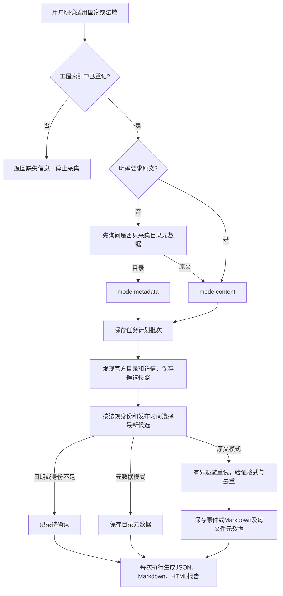

# law-crawler · 官方法规采集 Skill

`law-crawler` 将官方法规的目录采集、原文下载、来源记录、版本选择与去重整理成可按批次执行的流程。它的目的是建立**法域明确、来源可追溯、文件可核对、任务可重跑**的本地法规资料库，供后续研究或内容处理使用。

用户必须明确提供适用国家/法域，且该法域已记录在工程索引中。除非用户明确要求下载法规原文，agent 必须先询问是否只采集元数据（目录），获得选择后执行。采集结果不代表法规已核实为现行有效。

## Agent 支持与安装

同一个 [SKILL.md](skills/law-crawler/SKILL.md) 使用通用 Agent Skills 格式。运行代码只依赖完整Python 3.10+标准库（含ssl、sqlite3及系统文件锁）；浏览器辅助使用所在agent提供的工具，核心CLI无须专有连接器或当前对话。macOS/Linux使用POSIX锁，Windows使用msvcrt锁；当前完成macOS实跑与Windows分支模拟，尚无Windows实机验收。完整可维护源码统一位于`skills/law-crawler/`，复制整个目录即可使用；安装位置仅用于运行，不另行维护。

直接检查并安装完整skill，无须打包或生成代码：

```sh
python3 tools/check_skill.py
python3 tools/install_skill.py --agent codex
python3 tools/install_skill.py --agent claude
python3 tools/install_skill.py --agent opencode
python3 tools/install_skill.py --agent workbuddy
```

| Agent | 默认用户级安装目录 | 项目级安装目录 |
| --- | --- | --- |
| Codex | `$CODEX_HOME/skills/`，未配置时 `~/.codex/skills/` | `.agents/skills/` |
| Claude Code | `~/.claude/skills/` | `.claude/skills/` |
| OpenCode | `$XDG_CONFIG_HOME/opencode/skills/`，未配置时 `~/.config/opencode/skills/` | `.opencode/skills/` |
| WorkBuddy | `~/.workbuddy/skills/` | `.workbuddy/skills/` |

项目级安装用 `--scope project --project /path/to/project`。自定义技能集合目录用`--dest /path/to/skills`，其他完整技能包可用`--source /path/to/law-crawler`；安装器在目标集合目录下保留整个包的相对结构。安装后在目标 agent 的技能列表确认识别，必要时重新打开会话。本文验证安装器和包结构，不代表已在所有 agent 的交互会话逐一验收。Claude Code 与 OpenCode 路径分别依据 [Claude Code 官方文档](https://code.claude.com/docs/en/skills#choose-where-skills-load)和 [OpenCode 官方文档](https://opencode.ai/docs/skills/)。

## 使用前需要确认什么

如需在云服务器运行 Claude Code、接入 DeepSeek 并查看智能体与批次状态，参见[阿里云部署与只读 Web 看板](docs/deployment-ecs.md)。

| 必须确认 | 规则 |
| --- | --- |
| 适用国家/法域 | 用户显式提供；不能根据平台域名、历史任务或默认索引猜测。 |
| 索引登记 | skill随附`skills/law-crawler/countries/*/index.md`；已有工作区countries优先。EU 中明确列出的成员国章节也有效。未知法域在网络请求和任务创建前拒绝。 |
| 采集模式 | 未明确要求原文时，agent 询问“是否先只下载元数据（目录）？”，等待选择 `metadata` 或 `content`。 |
| 工作区与配置 | 工作区countries优先；源码工程无根countries时读取skill内索引与默认配置，下载相对路径仍按显式`--root`解析。 |

目前索引包含印度尼西亚、加拿大和 EU 聚合入口；EU 成员覆盖以文件实际章节为准，目前列有德国、法国、荷兰、意大利。EU 索引不代表全部 27 国、欧盟自身法规或所有平台都已适配。中文、规范英文及已登记 ISO 别名可用；别名不会绕过索引登记检查。

新工作区按包内[工作区准备](skills/law-crawler/references/workspace.md)执行。将SKILL_DIR替换为当前SKILL.md所在目录、WORK_ROOT替换为用户选定的绝对路径，选择实际Python 3.10+解释器：

```text
python -X utf8 "SKILL_DIR/scripts/prepare_workspace.py" --root "WORK_ROOT" --jurisdiction Canada
python -X utf8 "SKILL_DIR/scripts/prepare_workspace.py" --root "WORK_ROOT" --jurisdiction Canada --initialize
```

第一条只读检查；第二条仅在工作区尚无索引时按用户明确法域选择模板，并补齐缺失配置，不覆盖已有索引/配置，不访问网络或创建采集批次。已有索引未登记的法域不得借模板补入。返回逐平台`adapter_supported`，区分登记、适配及网络验收。

## 通用skill的维护约定

保持三级加载：frontmatter提供中英文触发及范围；SKILL.md保存必要输入、执行路由和交付约束；按需读取references，历史观察留在references/history。将可执行逻辑放scripts，将国家索引与默认配置直接维护在skill的countries目录。assets仅在实际需要其他产出资源时使用，不保存重复索引。当前无超过10k词的参考文件，历史资料仍提供定位关键词。

将生成来源标记放在`metadata.agent_created: "true"`，遵循[Agent Skills规范](https://agentskills.io/specification)的字符串映射扩展，而非新增私有顶层字段。SKILL.md不依赖会话历史、本机绝对路径、指定浏览器接口或本仓库旧报告；字段/URL等领域规则来自随包参考资料和用户工作区的真实索引，机器目录与工具能力在运行时解析。

将整个skill直接维护在[`skills/law-crawler/`](skills/law-crawler/)，包括说明、参考资料、国家索引、默认配置和运行代码。运行实现的唯一位置是[`scripts/law_crawler/`](skills/law-crawler/scripts/law_crawler/)，六个`scripts/*.py`仅作命令入口；不再生成代码副本或生成清单。根目录`law_crawler/__init__.py`仅为兼容导入桥，直接加载skill中的同一套模块。不要从外部工作区复制个人配置。目录职责、兼容入口与开发流程见[源码结构说明](docs/development.md)。

2026-10-15通用性复验：263项测试通过；独立代理仅用完整skill包在中文含空格临时目录完成18条前向命令观察，所有skill命令0次网络尝试。通用性审查报告保存在本地 `reports/`，不随源码发布。这不代表其他agent客户端界面、Windows实机或实时官网均已验收。

## 执行逻辑



元数据模式采集目录、详情、来源、法规身份、日期及原文链接，不请求法规原文附件。原文模式在选定候选后请求并验证文件。目录仅为有限发现范围；最新选择只针对本批次发现的候选，不保证全平台全历史的最新版本。

同法规不同版本、多来源均比较有证据的 `published_at`，取最新公布日期。必须有明确法规身份才能分组；未知日期、同日并列或身份不足保留候选并标记待确认；需要选择执行项时使用稳定来源排序，仍不认定唯一最新，不能拿下载时间、网页更新时间或 URL 排序代替最新公布日期。历史文件及来源记录继续保留。

## 命令示例

在 agent 中提出：

> 使用 law-crawler，适用法域加拿大，先只采集目录元数据，每个平台最多检查 4 个详情页。

> 使用 law-crawler，适用法域德国，下载法规原文，验证 1 份并检查去重。

在工程中直接运行：

```sh
# 加拿大目录元数据
python3 -m law_crawler download \
  --root "$PWD" --jurisdiction Canada --mode metadata \
  --platform all --limit 6 --per-platform-limit 2 --max-details 4

# 印尼原文：每平台限量1份
python3 -m law_crawler download \
  --root "$PWD" --jurisdiction Indonesia --mode content \
  --platform all --limit 11 --per-platform-limit 1 --max-details 3

# EU索引按成员国分流
python3 -m law_crawler download \
  --root "$PWD" --jurisdiction EU --mode content \
  --platform all --limit 4 --per-platform-limit 1 --max-details 2

# 仅生成计划，不访问网络
python3 -m law_crawler download \
  --root "$PWD" --jurisdiction Germany --mode metadata --plan-only

# 同一批次重跑失败和待执行项，沿用计划内法域与模式
python3 -m law_crawler download --root "$PWD" --rerun-batch BATCH_ID
```

独立命令入口为 `skills/law-crawler/scripts/download_regulations.py`，安装副本中的相对路径相同。新批次 CLI 强制显式提供 `--jurisdiction`（兼容显式 `--country` 别名）及 `--mode`，不会默认原文下载。`--index` 如指定须匹配法域登记索引。

| 参数 | 含义 |
| --- | --- |
| `--jurisdiction` / `--mode` | 新批次的显式法域和 `metadata` / `content` 模式。 |
| `--batch-id` | 自定义安全批次 ID；缺省生成新 ID。 |
| `--plan-only` | 仅生成参数执行计划，不访问网络。 |
| `--rerun-batch ID` | 沿用已有计划，重跑失败/待执行项；传入法域与模式时须一致。 |
| `--rerun-all` | 重跑全部项，已下载有效文件仍可命中缓存。 |
| `--max-attempts` | 默认 3 次，包含首次请求；失败后最多再试两次。 |
| `--backoff-base` | 指数退避等待基数，默认 1 秒。 |
| `--platform` / `--limit` | 平台域名或 `all`、原文总文件限量；目录发现范围由 `--max-details` 约束。 |
| `--per-platform-limit` / `--max-details` | 单平台原文文件限量、详情页检查上限；前者不限制目录条数。 |
| `--timeout` / `--delay` | 请求超时、详情间隔，默认 20 秒 / 1 秒。 |
| `--refresh` | 重取已知原文 URL，检查内容变化并保留历史。 |
| `--experimental-sources` | 显式启用 JDIHN 官方开发部署备用路径，成功不代表正式入口恢复。 |

详见 [批次工作流](skills/law-crawler/references/batch-workflow.md)。

## 保存位置与输出

源码工程的默认配置位于`skills/law-crawler/countries/global-config.properties`；独立用户工作区的配置位于其`countries/global-config.properties`并具有优先级。

```properties
downdloadDir=./downloads/
```

保留原键名 `downdloadDir`，兼容 `downloadDir`。基础目录内按国家分流；相对路径按 `--root` 解析，绝对基础目录同样追加国家子目录。目录拒绝符号链接和路径逃逸。

```text
downloads/
├── Indonesia/      # 文件、独立元数据和去重状态
├── Canada/
├── Germany/
├── France/
├── Netherlands/
├── Italy/
└── .batches/
    └── <batch-id>/  # 执行计划、候选快照和历次尝试报告
```

| 内容 | 保存与核对规则 |
| --- | --- |
| 目录元数据 | 每法规候选包含来源链接、身份、日期、原文链接、选择与处理状态。 |
| PDF、办公文档、扫描图片、ZIP | 按真实格式保留官方原始字节。 |
| HTML、XML、JSON 法规文本 | 转换为 Markdown 保存，保留原始响应审计副本及转换来源。 |
| 每文件元数据 | 每份下载内容单独生成 JSON，记录原格式/哈希、实际文件格式/哈希、所有来源及状态。 |
| `crawl-state.sqlite3` | URL、内容、请求状态和历史版本的持久索引。 |
| `.batches/<ID>/` | 保存批次计划及 `candidates.json` 原文 URL 快照。 |
| `attempts/0001/` 等 | 各次执行结果；生成机器 JSON、Markdown 与固定版式 HTML 报告。 |

HTML/XML/JSON 必须先确认是法规原文，不能将导航、错误页、挑战页转换后当成成功法规。文本转换保留层级和内容，结果完整性仍受来源与格式限制；PDF/扫描图片不自动 OCR，其他二进制格式不自动转换。详见 [文件格式](skills/law-crawler/references/file-formats.md)。

Markdown还需核对源结构，不能仅以文字片段存在或文件哈希正确验收。`structured_text_v2.4`字段标注仅显示名称和值，不追加`(XML 路径)`括号；保留日期角色、具名条款层级、表格行列/跨度、脚注及未知结构；双语节点分别标明English/Français并保留边界；加拿大登记日期、XML合并日期与制令日期分别标注，不混为公布日期。MathML保留源结构，缺失idref脚注标未解析。现有文件可用下述离线批次重建，旧Markdown及元数据保存在`conversion-history/`，原始字节、来源与请求计数保留；后续旧缓存也会自动升级。Markdown结构修复报告保存在本地 `reports/`。此前加拿大文本存在检查没有覆盖这些结构问题，不能继续作为结构验收证据。

```sh
python3 -m law_crawler rebuild-markdown \
  --root "$PWD" --jurisdiction Canada --batch-id canada-markdown-rebuild-RUN_ID

python3 -m law_crawler rebuild-markdown \
  --root "$PWD" --rerun-batch canada-markdown-rebuild-RUN_ID
```

元数据中 `published_at` 是法规公布日期，`updated_at` 是官方明确提供的网页/记录更新时间，`effective_region` 是适用国家/地区；缺证据时为 `null`。法域输入用于任务范围和存储，不自动证明每一法规全国适用或当前有效。字段说明见 [元数据](skills/law-crawler/references/schema.md)。

## 去重、重试与报告

去重保持 URL 规范化、本次队列、SQLite 持久状态、SHA-256 内容去重四层。相同字节合并来源，不同内容保留版本；不按标题相似或语义相似删除原件。复用前验证本地文件，缺失或损坏则重新获取。最新候选选择与字节去重分别记录，历史来源与证据不被新版本覆盖。

默认批次重跑先为全部有效成功缓存预留总量及平台额度，再处理失败/待执行项，避免限量跳过项因缓存未计数而扩采。历史异常超额文件保留，本轮报告按原计划限额呈现；本轮文件数与历史库存数分别报告。

每文件请求默认最多 3 次，指数退避等待；每次尝试及最终成功/失败均记录状态与原因，达到上限后继续其他项。缓存命中记录为复用，不伪造网络下载。TLS、403、未适配导出、错误页和浏览器工具故障需要明确区分，不能关闭 TLS 校验或绕过访问控制。

每轮报告提供 Markdown 和可离线阅读的固定版式 HTML，展示任务摘要、平台状态、文件/候选结果、失败原因及待确认项。执行退出码或一个成功样本不证明整个平台可用；结果以报告、实际文件和哈希核对为准。

## 工程维护与验证证据

目录树、唯一源码位置和检查流程见[源码结构说明](docs/development.md)。下载资料、历史报告及临时文件继续留在本地独立目录，不随源码整理迁移。

| 路径 | 职责 |
| --- | --- |
| [SKILL.md](skills/law-crawler/SKILL.md) | 跨 agent 输入确认、执行和交付说明。 |
| `skills/law-crawler/scripts/law_crawler/jurisdiction_registry.py` | 只读索引登记与法域校验。 |
| `skills/law-crawler/scripts/law_crawler/download_regulations.py`、同目录`platform_adapters/` | 执行调度与官方目录/详情解析。 |
| `skills/law-crawler/scripts/law_crawler/`中的存储、格式和元数据模块 | 存储、去重、格式和元数据基础能力。 |
| `skills/law-crawler/scripts/` | 直接维护的唯一完整运行包与六个命令入口。 |
| `law_crawler/__init__.py` | 工程兼容导入桥，加载上述运行包，无业务实现。 |
| `skills/law-crawler/countries/` | 国家索引及默认配置，直接维护并随skill安装。 |
| 根目录四个Python命令 | 仅兼容旧CLI，实际实现位于skill内的law_crawler包。 |
| `observer/`、`deploy/` | 独立看板和服务器部署，不打入skill。 |
| `tools/install_skill.py` | 目标 agent 安装；不修改权限配置。 |
| `tests/` | 自动化测试与固定样本。 |
| `reports/` | 本地验证报告与历史实跑证据，已加入 `.gitignore`，不纳入版本控制。 |

```sh
python3 tools/check_skill.py
python3 -m unittest discover -s tests -v
python3 tools/install_skill.py --agent codex
```

`check_skill.py`只读检查必需资源、Python语法与内部依赖，不改写文件；安装器直接复制完整skill目录，不生成另一套源码。独立 skill 包不包含下载原件或状态数据库。本次源码归并通过363项测试；独立测试子代理在中文含空格临时路径验证了完整skill副本的初始化、加拿大计划与同批次重跑，产出两轮Markdown、HTML报告，未访问网络。新增平台必须验证官方目录→详情→原文链路，再复跑核对去重；离线测试不替代真实网络验收。

最新目录选择保存在各国家目录 `latest-selection.json`；已下载资料的当前版本选择保存在 `current-regulations.json`。每份文件的 JSON 同时记录 `selection` 与 `preferred_source`，历史原件继续保留。目录候选按法规身份、公布日期和官方文本版本区分，未知日期不会覆盖已有明确新版。

每轮还有 `attempts/000N/execution-plan.json`、`execution-plan.md` 和下载前的 `file-plan.json`；同一批次不允许并发执行。默认重跑沿用已成功文件，恢复失败的目录/详情发现和未完成原件任务；正文格式中的其余链接作为备选，已取得一个可用格式后记录跳过。

历史采集、核验更正与浏览器排查记录见[历史样本验证](docs/validation-history.md)；当前能力按实际运行报告确认。

跨agent浏览器分层对照可运行以下命令，用自己可用的浏览器工具访问stdout中返回的URL，并核对fixture.json中的marker和实际附件SHA；诊断文件保存在报告证据目录，不导入法规库：

```sh
python3 -m law_crawler browser-healthcheck \
  --duration 180 --output-dir reports/browser-healthcheck-RUN_ID
```
