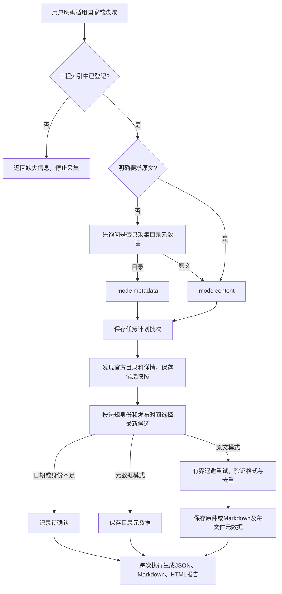

# law-crawler · 官方法规采集 Skill

`download-official-regulations` 将官方法规的目录采集、原文下载、来源记录、版本选择与去重整理成可按批次执行的流程。它的目的是建立**法域明确、来源可追溯、文件可核对、任务可重跑**的本地法规资料库，供后续研究或内容处理使用。

用户必须明确提供适用国家/法域，且该法域已记录在工程索引中。除非用户明确要求下载法规原文，agent 必须先询问是否只采集元数据（目录），获得选择后执行。采集结果不代表法规已核实为现行有效。

## Agent 支持与安装

同一个 [SKILL.md](skills/download-official-regulations/SKILL.md) 使用通用 Agent Skills 格式。运行代码只依赖完整Python 3.10+标准库（含ssl、sqlite3及系统文件锁）；浏览器辅助使用所在agent提供的工具，核心CLI无须专有连接器或当前对话。macOS/Linux使用POSIX锁，Windows使用msvcrt锁；当前完成macOS实跑与Windows分支模拟，尚无Windows实机验收。工程源码是唯一维护来源，安装位置是副本。

先打包，再选择安装目标：

```sh
python3 tools/sync_skill.py
python3 tools/install_skill.py --agent codex
python3 tools/install_skill.py --agent claude
python3 tools/install_skill.py --agent opencode
python3 tools/install_skill.py --agent workbuddy
```

| Agent | 默认用户级安装目录 | 项目级安装目录 |
| --- | --- | --- |
| Codex | `$CODEX_HOME/skills/`，未配置时 `~/.codex/skills/` | `.agents/skills/` |
| Claude Code | `~/.claude/skills/` | `.claude/skills/` |
| OpenCode | `$XDG_CONFIG_HOME/opencode/skills/`，未配置时 `~/.config/opencode/skills/` | `.opencode/skills/` |
| WorkBuddy | `~/.workbuddy/skills/` | `.workbuddy/skills/` |

项目级安装用 `--scope project --project /path/to/project`。自定义技能集合目录用`--dest /path/to/skills`，其他完整技能包可用`--source /path/to/download-official-regulations`；安装器在目标集合目录下保留整个包的相对结构。安装后在目标 agent 的技能列表确认识别，必要时重新打开会话。本文验证安装器和包结构，不代表已在所有 agent 的交互会话逐一验收。Claude Code 与 OpenCode 路径分别依据 [Claude Code 官方文档](https://code.claude.com/docs/en/skills#choose-where-skills-load)和 [OpenCode 官方文档](https://opencode.ai/docs/skills/)。

## 使用前需要确认什么

| 必须确认 | 规则 |
| --- | --- |
| 适用国家/法域 | 用户显式提供；不能根据平台域名、历史任务或默认索引猜测。 |
| 索引登记 | `countries/*/index.md` 中存在；EU 中明确列出的成员国章节也有效。未知法域在网络请求和任务创建前拒绝。 |
| 采集模式 | 未明确要求原文时，agent 询问“是否先只下载元数据（目录）？”，等待选择 `metadata` 或 `content`。 |
| 工作区与配置 | 工作区索引优先，读取 `countries/global-config.properties`；显式 `--root`。 |

目前索引包含印度尼西亚、加拿大和 EU 聚合入口；EU 成员覆盖以文件实际章节为准，目前列有德国、法国、荷兰、意大利。EU 索引不代表全部 27 国、欧盟自身法规或所有平台都已适配。中文、规范英文及已登记 ISO 别名可用；别名不会绕过索引登记检查。

新工作区按包内[工作区准备](skills/download-official-regulations/references/workspace.md)执行。将SKILL_DIR替换为当前SKILL.md所在目录、WORK_ROOT替换为用户选定的绝对路径，选择实际Python 3.10+解释器：

```text
python -X utf8 "SKILL_DIR/scripts/prepare_workspace.py" --root "WORK_ROOT" --jurisdiction Canada
python -X utf8 "SKILL_DIR/scripts/prepare_workspace.py" --root "WORK_ROOT" --jurisdiction Canada --initialize
```

第一条只读检查；第二条仅在工作区尚无索引时按用户明确法域选择模板，并补齐缺失配置，不覆盖已有索引/配置，不访问网络或创建采集批次。已有索引未登记的法域不得借模板补入。返回逐平台`adapter_supported`，区分登记、适配及网络验收。

## 通用skill的维护约定

保持三级加载：frontmatter提供中英文触发及范围；SKILL.md保存必要输入、执行路由和交付约束；按需读取references，历史观察留在references/history。将可执行逻辑放scripts，将索引/配置复制模板放assets，不把assets当额外模型指令。当前无超过10k词的参考文件，历史资料仍提供定位关键词。

将生成来源标记放在`metadata.agent_created: "true"`，遵循[Agent Skills规范](https://agentskills.io/specification)的字符串映射扩展，而非新增私有顶层字段。SKILL.md不依赖会话历史、本机绝对路径、指定浏览器接口或本仓库旧报告；字段/URL等领域规则来自随包参考资料和用户工作区的真实索引，机器目录与工具能力在运行时解析。

先修改本工程`skills/download-official-regulations/`文档及独立辅助脚本；核心采集运行模块和platform_adapters源码位于工程根目录，scripts中的对应文件由`tools/sync_skill.py`打包。运行`python3 tools/sync_skill.py --check`检查漂移，再安装到选定agent目录，不仅修改安装副本。工作区准备和浏览器诊断辅助脚本直接维护在工程skill目录；`assets/global-config.properties`作为通用相对路径模板独立维护，不从工作区配置复制，避免把个人下载目录传播到安装包。

2026-10-15通用性复验：263项测试通过；独立代理仅用完整skill包在中文含空格临时目录完成18条前向命令观察，所有skill命令0次网络尝试。详情见[通用性审查报告](reports/skill-generality-review-2026-10-15.md) / [HTML](reports/skill-generality-review-2026-10-15.html)。这不代表其他agent客户端界面、Windows实机或实时官网均已验收。

## 执行逻辑



元数据模式采集目录、详情、来源、法规身份、日期及原文链接，不请求法规原文附件。原文模式在选定候选后请求并验证文件。目录仅为有限发现范围；最新选择只针对本批次发现的候选，不保证全平台全历史的最新版本。

同法规不同版本、多来源均比较有证据的 `published_at`，取最新公布日期。必须有明确法规身份才能分组；未知日期、同日并列或身份不足保留候选并标记待确认；需要选择执行项时使用稳定来源排序，仍不认定唯一最新，不能拿下载时间、网页更新时间或 URL 排序代替最新公布日期。历史文件及来源记录继续保留。

## 命令示例

在 agent 中提出：

> 使用 download-official-regulations，适用法域加拿大，先只采集目录元数据，每个平台最多检查 4 个详情页。

> 使用 download-official-regulations，适用法域德国，下载法规原文，验证 1 份并检查去重。

在工程中直接运行：

```sh
# 加拿大目录元数据
python3 download_regulations.py \
  --root "$PWD" --jurisdiction Canada --mode metadata \
  --platform all --limit 6 --per-platform-limit 2 --max-details 4

# 印尼原文：每平台限量1份
python3 download_regulations.py \
  --root "$PWD" --jurisdiction Indonesia --mode content \
  --platform all --limit 11 --per-platform-limit 1 --max-details 3

# EU索引按成员国分流
python3 download_regulations.py \
  --root "$PWD" --jurisdiction EU --mode content \
  --platform all --limit 4 --per-platform-limit 1 --max-details 2

# 仅生成计划，不访问网络
python3 download_regulations.py \
  --root "$PWD" --jurisdiction Germany --mode metadata --plan-only

# 同一批次重跑失败和待执行项，沿用计划内法域与模式
python3 download_regulations.py --root "$PWD" --rerun-batch BATCH_ID
```

打包脚本为 `skills/download-official-regulations/scripts/download_regulations.py`，安装副本中的相对路径相同。新批次 CLI 强制显式提供 `--jurisdiction`（兼容显式 `--country` 别名）及 `--mode`，不会默认原文下载。`--index` 如指定须匹配法域登记索引。

| 参数 | 含义 |
| --- | --- |
| `--jurisdiction` / `--mode` | 新批次的显式法域和 `metadata` / `content` 模式。 |
| `--batch-id` | 自定义安全批次 ID；缺省生成新 ID。 |
| `--plan-only` | 仅生成参数执行计划，不访问网络。 |
| `--rerun-batch ID` | 沿用已有计划，重跑失败/待执行项；传入法域与模式时须一致。 |
| `--rerun-all` | 重跑全部项，已下载有效文件仍可命中缓存。 |
| `--max-attempts` | 默认 3 次，包含首次请求；失败后最多再试两次。 |
| `--backoff-base` | 指数退避等待基数，默认 1 秒。 |
| `--platform` / `--limit` | 平台域名或 `all`、原文总文件限量；目录发现范围由 `--max-details` 约束。 |
| `--per-platform-limit` / `--max-details` | 单平台原文文件限量、详情页检查上限；前者不限制目录条数。 |
| `--timeout` / `--delay` | 请求超时、详情间隔，默认 20 秒 / 1 秒。 |
| `--refresh` | 重取已知原文 URL，检查内容变化并保留历史。 |
| `--experimental-sources` | 显式启用 JDIHN 官方开发部署备用路径，成功不代表正式入口恢复。 |

详见 [批次工作流](skills/download-official-regulations/references/batch-workflow.md)。

## 保存位置与输出

```properties
downdloadDir=./downloads/
```

保留原键名 `downdloadDir`，兼容 `downloadDir`。基础目录内按国家分流；相对路径按 `--root` 解析，绝对基础目录同样追加国家子目录。目录拒绝符号链接和路径逃逸。

```text
downloads/
├── Indonesia/      # 文件、独立元数据和去重状态
├── Canada/
├── Germany/
├── France/
├── Netherlands/
├── Italy/
└── .batches/
    └── <batch-id>/  # 执行计划、候选快照和历次尝试报告
```

| 内容 | 保存与核对规则 |
| --- | --- |
| 目录元数据 | 每法规候选包含来源链接、身份、日期、原文链接、选择与处理状态。 |
| PDF、办公文档、扫描图片、ZIP | 按真实格式保留官方原始字节。 |
| HTML、XML、JSON 法规文本 | 转换为 Markdown 保存，保留原始响应审计副本及转换来源。 |
| 每文件元数据 | 每份下载内容单独生成 JSON，记录原格式/哈希、实际文件格式/哈希、所有来源及状态。 |
| `crawl-state.sqlite3` | URL、内容、请求状态和历史版本的持久索引。 |
| `.batches/<ID>/` | 保存批次计划及 `candidates.json` 原文 URL 快照。 |
| `attempts/0001/` 等 | 各次执行结果；生成机器 JSON、Markdown 与固定版式 HTML 报告。 |

HTML/XML/JSON 必须先确认是法规原文，不能将导航、错误页、挑战页转换后当成成功法规。文本转换保留层级和内容，结果完整性仍受来源与格式限制；PDF/扫描图片不自动 OCR，其他二进制格式不自动转换。详见 [文件格式](skills/download-official-regulations/references/file-formats.md)。

Markdown还需核对源结构，不能仅以文字片段存在或文件哈希正确验收。`structured_text_v2.3`字段标注仅显示名称和值，不追加`(XML 路径)`括号；保留日期角色、具名条款层级、表格行列/跨度、脚注及未知结构；加拿大登记日期、XML合并日期与制令日期分别标注，不混为公布日期。MathML保留源结构，缺失idref脚注标未解析。现有文件可用下述离线批次重建，旧Markdown及元数据保存在`conversion-history/`，原始字节、来源与请求计数保留；后续旧缓存也会自动升级。完整排查见 [Markdown结构修复报告](reports/markdown-structure-repair-2026-10-15.md) / [HTML报告](reports/markdown-structure-repair-2026-10-15.html)。此前加拿大文本存在检查没有覆盖这些结构问题，不能继续作为结构验收证据。

```sh
python3 skills/download-official-regulations/scripts/rebuild_markdown.py \
  --root "$PWD" --jurisdiction Canada --batch-id canada-markdown-rebuild-RUN_ID

python3 skills/download-official-regulations/scripts/rebuild_markdown.py \
  --root "$PWD" --rerun-batch canada-markdown-rebuild-RUN_ID
```

元数据中 `published_at` 是法规公布日期，`updated_at` 是官方明确提供的网页/记录更新时间，`effective_region` 是适用国家/地区；缺证据时为 `null`。法域输入用于任务范围和存储，不自动证明每一法规全国适用或当前有效。字段说明见 [元数据](skills/download-official-regulations/references/schema.md)。

## 去重、重试与报告

去重保持 URL 规范化、本次队列、SQLite 持久状态、SHA-256 内容去重四层。相同字节合并来源，不同内容保留版本；不按标题相似或语义相似删除原件。复用前验证本地文件，缺失或损坏则重新获取。最新候选选择与字节去重分别记录，历史来源与证据不被新版本覆盖。

默认批次重跑先为全部有效成功缓存预留总量及平台额度，再处理失败/待执行项，避免限量跳过项因缓存未计数而扩采。历史异常超额文件保留，本轮报告按原计划限额呈现；本轮文件数与历史库存数分别报告。

每文件请求默认最多 3 次，指数退避等待；每次尝试及最终成功/失败均记录状态与原因，达到上限后继续其他项。缓存命中记录为复用，不伪造网络下载。TLS、403、未适配导出、错误页和浏览器工具故障需要明确区分，不能关闭 TLS 校验或绕过访问控制。

每轮报告提供 Markdown 和可离线阅读的固定版式 HTML，展示任务摘要、平台状态、文件/候选结果、失败原因及待确认项。执行退出码或一个成功样本不证明整个平台可用；结果以报告、实际文件和哈希核对为准。

## 工程维护与验证证据

| 路径 | 职责 |
| --- | --- |
| [SKILL.md](skills/download-official-regulations/SKILL.md) | 跨 agent 输入确认、执行和交付说明。 |
| `jurisdiction_registry.py` | 只读索引登记与法域校验。 |
| `download_regulations.py`、`platform_adapters/` | 执行调度与官方目录/详情解析。 |
| `crawl_store.py`、`document_formats.py`、`regulation_metadata.py` | 存储、去重、格式和元数据基础能力。 |
| `skills/download-official-regulations/scripts/`、`assets/` | 自动打包运行代码及模板。 |
| `tools/install_skill.py` | 目标 agent 安装；不修改权限配置。 |
| `tests/`、`reports/` | 自动验证与历史实跑证据。 |

```sh
python3 tools/sync_skill.py
python3 tools/sync_skill.py --check
python3 -m unittest discover -s tests -v
python3 tools/install_skill.py --agent codex
```

`sync_skill.py --install` 保留兼容 Codex 的打包安装流程；其他 agent 使用显式安装器。独立 skill 包不包含下载原件或状态数据库。新增平台必须验证官方目录→详情→原文链路，再复跑核对去重；离线测试不替代真实网络验收。

历史样本证据：印尼五平台报告（历史报告当前工作区缺失）、加拿大报告（历史报告当前工作区缺失）、EU 成员国报告（历史报告当前工作区缺失）。这些报告形成于先前流程，只说明对应时间的样本，不证明本轮改造的全部能力已通过网络验收。


最新目录选择保存在各国家目录 `latest-selection.json`；已下载资料的当前版本选择保存在 `current-regulations.json`。每份文件的 JSON 同时记录 `selection` 与 `preferred_source`，历史原件继续保留。目录候选按法规身份、公布日期和官方文本版本区分，未知日期不会覆盖已有明确新版。

每轮还有 `attempts/000N/execution-plan.json`、`execution-plan.md` 和下载前的 `file-plan.json`；同一批次不允许并发执行。默认重跑沿用已成功文件，恢复失败的目录/详情发现和未完成原件任务；正文格式中的其余链接作为备选，已取得一个可用格式后记录跳过。

本轮十项要求评估与验证见 Markdown 评估报告（历史报告当前工作区缺失） 和 HTML 评估报告（历史报告当前工作区缺失）。

优化后加拿大两阶段、Markdown转换及批次重跑实测见 验证汇总（历史报告当前工作区缺失） 和 HTML汇总（历史报告当前工作区缺失）。

2026-10-15重新验证见 [Markdown汇总](reports/canada-optimized-validation-2026-10-15.md) / [HTML汇总](reports/canada-optimized-validation-2026-10-15.html)：先保存8条目录且原文请求0，首轮下载4份XML并转Markdown。默认重跑暴露并修复缓存额度未计入导致多采3份的问题，问题轮和7对原XML/Markdown均保留；修复后默认复用4份、0原文请求，全项刷新4次均为内容重复。当前官方页面声明合并文本截至2026-09-21，公布日未知保留待确认，不宣称全站唯一最新。两种报告生成及静态结构核对通过，浏览器file URL预览受策略限制，未作视觉验收。

优化后印尼两阶段验证见 [Markdown汇总](reports/indonesia-optimized-validation-2026-10-14.md) 和 [HTML汇总](reports/indonesia-optimized-validation-2026-10-14.html)：16条目录、14份PDF，默认重跑复用14份，刷新重跑14份内容重复。实际样本全部PDF，未发生印尼正文转Markdown；HTML/XML/JSON转换由离线回归覆盖。仍有4个平台存在TLS/403访问失败，JDIHN为显式官方dev备用链路。

首轮审查当时记录12份身份匹配、1份扫描件待核验，并仅凭卫生部PMK23/2022提取层的`RANCANGAN`记录目录正文类型冲突（该判断已在后续更正）。`import_body_review.py`登记显式证据，文件JSON与SQLite保存`body_review`；审核随原SHA保留。当时原件清单13条候选，历史原字节及批次报告保持保留。用法见 [印尼验证说明](skills/download-official-regulations/references/indonesia.md)。

后续排查与更正见 [Markdown报告](reports/indonesia-recovery-followup-2026-10-14.md) / [HTML报告](reports/indonesia-recovery-followup-2026-10-14.html)。MK正常浏览器目录加CLI公开原件已补收PMK1/2026和PMK7/2025，显式128MiB离线导入，重跑existing2/content_duplicate2；CLI目录仍403。其余3个平台仍TLS/403受阻，DPR历史汇编不替代2025原件。

此前两份异常已补核：PERMA2/2015扫描页视觉身份匹配；PMK23/2022的`RANCANGAN`为白色隐藏文字，正式渲染、公布/认证页支持身份，原先仅凭提取判冲突的结论已更正。`body_review_history`保留前次审核，原文件与旧批次报告不改写。国家目录现16份PDF全部完成限定页面身份核验；5份公布日期仍未知，不代表全站最新或效力已核实。同内容同来源的新目录未知字段不覆盖已有observed证据，新来源/字节不继承。

`import_browser_download.py --acquisition-method official_cli_download`记录真实CLI取得方式，报告模式为`official_file_import`，默认浏览器行为兼容；取得方式和大小上限随批次计划冻结。`official_fetch(..., max_bytes=...)`可为已核实的大原件显式调整响应上限，标准CLI默认仍40MiB，白名单和TLS验证保持启用。

三平台继续排查见 [Markdown报告](reports/indonesia-three-browser-recovery-2026-10-14.md) / [HTML报告](reports/indonesia-three-browser-recovery-2026-10-14.html)。IAB连接/标签/导航可用而DOM和截图读取超时，关闭大PDF未修复；本机Chrome原生读取与截图替代通道已实际验证。正常浏览器仍看到BPK Riau/E-PPID拒绝、DPR当前原件Akamai拒绝、peraturan连接关闭，本轮新增原件0，库存16份原字节保持一致。DPR印尼语数字详情与旧英语详情公布日25/26 February 2025差异保留，未猜测合并。流程见 [浏览器分层排障](skills/download-official-regulations/references/browser-workflow.md)。

10月15日排查见 [Markdown报告](reports/indonesia-iab-repair-2026-10-15.md) / [HTML报告](reports/indonesia-iab-repair-2026-10-15.html)：IAB官网读取在50秒外层调用时限下已通过，后台DOM实测约30秒；明确附件响应的诊断文件实际下载并通过字节/SHA核对，普通download属性链接仍未返回事件。新增便携诊断服务直接维护在工程skill中，不计法规库存。Chrome新官方BPK地区入口、DPR3/2025原文及DJPP公报导航仍拒绝或断开，新增法规0；没有原字节时不扩展白名单或创建成功文件元数据。

跨agent浏览器分层对照可运行以下命令，用自己可用的浏览器工具访问stdout中返回的URL，并核对fixture.json中的marker和实际附件SHA；诊断文件保存在报告证据目录，不导入法规库：

```sh
python3 skills/download-official-regulations/scripts/browser_healthcheck.py \
  --duration 180 --output-dir reports/browser-healthcheck-RUN_ID
```
